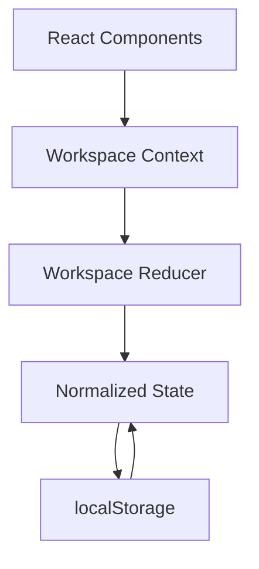

# Nexus Workspace

Nexus Workspace is a task management application built with React, TypeScript, and Vite. It helps users organize projects using boards, columns, and task cards.

## Features

- Create, search, and delete boards.
- Create, rename, and delete columns.
- Create, edit, delete, and move tasks.
- Add tags, due dates, and Markdown descriptions.
- Save workspace data in localStorage.
- Responsive design and an accessible task modal.

## Tech Stack

- React + TypeScript
- Vite
- React Router
- React Context and `useReducer`
- React Markdown
- CSS and localStorage

## Getting Started

```bash
npm install
npm run dev
```

Build for production:

```bash
npm run build
```

## Folder Structure

```text
src/
├── app/           # Routing
├── components/
│   ├── dashboard/ # Board listing and cards
│   └── board/     # Columns, tasks, and task form
├── context/       # Shared workspace state
├── hooks/         # Reusable React hooks
├── state/         # Actions and reducer
├── types/         # TypeScript interfaces
├── utils/         # Storage utilities
├── styles/        # Global CSS
└── main.tsx       # Application entry point
```

## State Architecture

Workspace data is normalized into separate records for boards, columns, and tasks. IDs connect related records.



The reducer handles state changes in one place, while Context makes shared state available throughout the application. localStorage saves changes so data survives browser refreshes.

Normalization makes entities easier to update and helps maintain consistent relationships when tasks move or columns are deleted.

## Performance Strategy

- **Lazy loading:** The board page loads separately from the dashboard.
- **Memoization:** `BoardCard` and `TaskCardItem` use `React.memo` to avoid some unnecessary renders.
- **Immutable updates:** The reducer returns updated state instead of mutating existing data.
- **Direct lookup:** Normalized records allow entities to be accessed by ID.

## Key Engineering Decisions

- **React + TypeScript:** Reusable components and clearer data types.
- **Context + reducer:** Centralized state management without an additional state library.
- **Normalized state:** Easier updates and relationship management.
- **localStorage:** Simple persistence without requiring a backend.
- **Custom CSS:** Control over the interface and responsive layout.
- **Accessibility:** Keyboard navigation and focus management in the task modal.

## Limitations

Data is stored locally in the browser. The application does not currently support accounts, cloud synchronization, or real-time collaboration.

## Future Improvements

- Add automated tests.
- Improve validation and recovery for stored data.
- Add a backend if multi-user collaboration is required.
