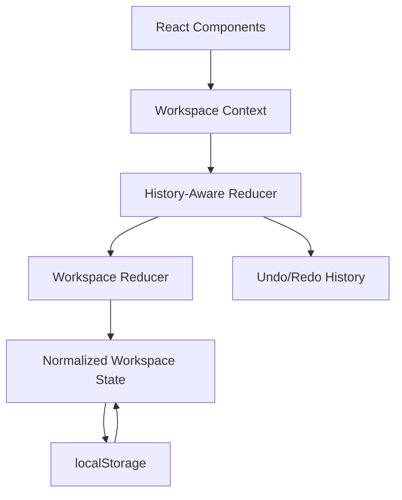

# Nexus Workspace

Nexus Workspace is a task management application built with React, TypeScript, and Vite. It helps users organize projects into boards, columns, and task cards, with support for drag-and-drop task management, threaded comments, and undo/redo functionality.

## Features

### Board and Task Management
- Create, search, and delete boards.
- Create, rename, and delete columns.
- Create, edit, delete, and move tasks between columns.
- Reorder tasks using drag-and-drop.
- Add tags, due dates, and Markdown-formatted descriptions.
- Add, edit, delete, and reply to task comments.

### Workspace State and History
- Centralized state management using React Context and `useReducer`.
- Normalized state for boards, columns, tasks, and comments.
- Undo and redo actions using a history-aware reducer.
- Keyboard shortcuts: `Ctrl + Z` to undo, `Ctrl + Y` or `Ctrl + Shift + Z` to redo.
- A bounded history of up to 50 previous workspace states.
- Workspace persistence using `localStorage`.
- Cross-tab synchronization for supported card creation and movement events.

### User Experience and Accessibility
- Responsive layout for different screen sizes.
- Accessible task forms and modal interactions.
- Keyboard-accessible task controls.
- Markdown rendering for task descriptions.
- Memoized components to reduce unnecessary rendering work.

## Tech Stack

- **React** — component-based user interface.
- **TypeScript** — static typing and safer state updates.
- **Vite** — development server and production build tooling.
- **React Router** — client-side routing.
- **React Context and `useReducer`** — shared state management.
- **@dnd-kit** — drag-and-drop interactions.
- **React Markdown** — Markdown description rendering.
- **CSS** — custom styling and responsive layouts.
- **localStorage** — local workspace persistence.

## Getting Started

### Prerequisites

- Node.js
- npm

### Installation

Clone the repository and install dependencies:

```bash
git clone https://github.com/bolutej/Nexus-Workspace.git
cd Nexus-Workspace
npm install
```

### Development

Start the development server:

```bash
npm run dev
```

### Production Build

Create a production build:

```bash
npm run build
```

## Project Structure

```text
src/
├── app/           # Application routing
├── components/
│   ├── dashboard/ # Board listing and dashboard components
│   └── board/     # Columns, task cards, forms, and comments
├── context/       # Shared workspace context
├── hooks/         # Reusable React hooks
├── state/         # Actions, reducers, and history management
├── types/         # TypeScript interfaces and types
├── utils/         # Storage and utility functions
├── styles/        # Global and shared CSS
└── main.tsx       # Application entry point
```

## State Architecture

Workspace data is stored in a normalized structure. Boards, columns, task cards, and comments are maintained in separate records, with IDs connecting related entities.

The workspace reducer handles application actions, while the history-aware reducer manages previous and future workspace states for undo and redo.



### State Management Principles

- **Centralized updates:** Actions describe state changes and reducers apply them.
- **Normalized entities:** IDs connect boards, columns, tasks, and comments.
- **Immutable updates:** Reducers produce updated state without directly mutating existing state.
- **History management:** Undo and redo restore previous workspace snapshots, with a maximum of 50 retained history entries.
- **Persistence:** Workspace data is saved locally and restored when the application initializes.

## Performance Strategy

### Lazy Loading

The board page is loaded separately from the dashboard to help reduce the initial JavaScript workload, where supported by the application's route configuration.

### Memoization

`BoardCard` and `TaskCardItem` use `React.memo` to skip rendering when their props have not changed. This is most useful when parent components update but the individual component's inputs remain the same.

### Normalized State and Direct Lookup

Entities are accessed by ID instead of repeatedly searching nested collections. This simplifies updates and supports predictable state relationships.

### Immutable Updates

Immutable reducer updates help React detect state changes and support reliable history snapshots.

## Accessibility

Accessibility considerations include semantic HTML, accessible labels for task controls, keyboard interactions, and focus management in task modal flows.

Keyboard shortcuts support undo and redo while avoiding standard text-entry fields.

## Persistence and Synchronization

Workspace data is persisted in the browser using `localStorage`.

Cross-tab synchronization supports card creation and movement through the workspace synchronization layer. Undo/redo history is currently maintained in memory and resets when the page is refreshed.

The application uses local browser storage rather than a centralized backend for workspace persistence.

## Limitations

- Workspace data is stored locally rather than in a cloud database.
- User accounts and server-side persistence are not currently provided.
- Cross-tab synchronization is limited to the supported card events.
- Undo/redo history does not persist across page refreshes.
- Automated test coverage should be added or expanded as the project develops.

## Future Improvements

- Add automated unit, integration, and end-to-end tests.
- Improve validation and recovery for corrupted or outdated stored data.
- Expand synchronization to additional workspace actions.
- Persist undo/redo history if required.
- Introduce a backend and authentication for multi-user collaboration.

## License

Add the license applicable to this project if you intend to distribute it publicly.
